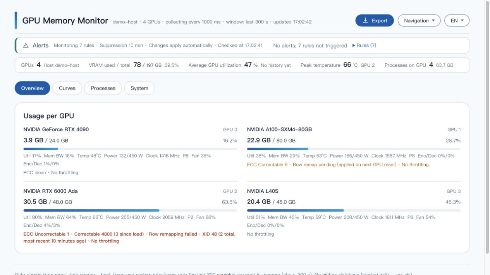
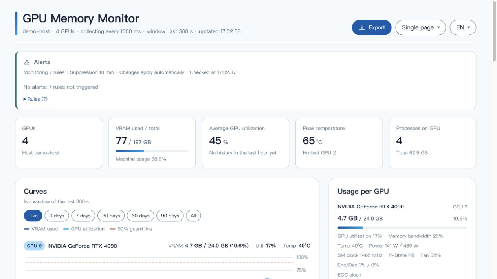

# GPU Memory Monitor

Real-time VRAM utilisation dashboard for a single machine with multiple GPUs. **Zero dependencies**: Node built-ins plus `nvidia-smi` — no `npm install`, no build step, no frontend framework.

[中文](README.md) | **English**

[](LICENSE)
[](docs/deployment.md)


[](https://github.com/cmzt-coder/gpu-monitor/actions/workflows/ci.yml)

**Navigation mode** — one tab per concern, with the persistent area squeezed into a line or two (on an 8-GPU box each card also fits its metrics on a single line). The screenshots below show the English UI; the Chinese one is in the [Chinese README](README.md).



**Single-page mode** — every card on one page, so charts and per-GPU cards are visible together.



<sub>Both screenshots use <code>--mock</code> sample data: GPU models, service names and the hostname are fake (the hostname always renders as <code>demo-host</code>).</sub>

## Quick start

```bash
git clone https://github.com/cmzt-coder/gpu-monitor.git
cd gpu-monitor
node server.js --port 8090              # needs Node >= 18; any NVIDIA GPU will show up
node server.js --mock --port 8090       # on a machine without a GPU, to preview the UI
```

Open <http://localhost:8090/>. To deploy it on a server and make it survive reboots (script / systemd / cron watchdog / Docker), or if you hit Node-version or timezone issues, see the deployment guide (Chinese) — the commands are copy-pasteable.

## What it does

- **Two display modes, switchable at any time**: *single page* lays every card out at once for comparing trends; *navigation* splits things into four tabs (Overview / Curves / Processes / System). The choice is kept in the URL and in local storage
- **Per-GPU live curves**: one VRAM line and one utilisation line per card. The window is `--window` points × `--interval`, so its duration depends on the sampling interval (1 s → 5 min, 3 s → 15 min). After a restart the page **backfills the gap from the history database**, and gaps are drawn as gaps
- **Hover any curve to read values**: a vertical guide plus a tooltip that follows the pointer, showing the timestamp and each series at that moment (per-GPU, per-service and system charts). Empty regions and gaps honestly report "no data"
- **Per-service VRAM curve**: GPU memory aggregated by service (container / systemd unit / login session), top 5 plus an "other" bucket — answers "who ate the VRAM"
- **Process list and process history**: PID, name, **service attribution**, usage and share per card, filterable by GPU; history is kept per identity change (plus 5-minute snapshots), answering "who took which card, and when"
- **Hardware health**: ECC (correctable / uncorrectable, current-driver and lifetime), row remapping and XID — the question is *is it growing*, not what the number is. When the data is unreadable it says so instead of showing 0
- **Alerting**: thresholds for VRAM / temperature / throttling / utilisation / host memory / disk / collection outages, including **per-service** rules and hardware-health metrics, with "must hold for N minutes" and cooldown suppression. Channels: **email**, webhook and console
- **Export**: a single entry point — pick content, layout (the GPU table can be wide: one row per sample, one column group per GPU), time range and options. CSV carries both local time and UTC
- **History**: SQLite storage (`data/gpu-monitor.db`) survives restarts; the page switches between live / 3d / 7d / 30d / 60d / 90d / all
- **Bilingual UI (Chinese / English)**: the `中 / EN` dropdown in the top bar takes effect immediately — no reload, no service restart — and the choice is remembered in local storage. The default follows `navigator.language`; a single link can pin a language with `?lang=en-US` or `#lang=en-US`
- Also: host metrics (CPU / memory / swap / load / disk / network), SSE push with automatic fallback to polling, idle down-throttling, 90% warning line, and copy-pasteable troubleshooting commands when something breaks

## Platform support

| Platform | Status | How it reads data |
| --- | --- | --- |
| Linux | ✅ full | `nvidia-smi` (`PATH` / `/usr/bin` / `/usr/local/bin`, plus WSL2's `/usr/lib/wsl/lib`) |
| Windows | ✅ full | `nvidia-smi.exe` (`PATH` / `C:\Windows\System32` / `NVSMI`) |
| macOS | ❌ not applicable | NVIDIA dropped driver support, so there is no `nvidia-smi`; the page says so explicitly while the service itself starts fine (use `--mock` to preview) |

NVIDIA only for now; AMD (`rocm-smi`) and Intel (`xpu-smi`) are not implemented, but the detection layer leaves room for them. Extended fields (clocks / P-State / fan / PCIe / encoder-decoder / throttle reasons / ECC counters) are probed field by field and hidden when the driver does not report them; `--no-extended` turns them off entirely.

## Documentation

The detailed documentation is currently **in Chinese**:

| Document | Contents |
| --- | --- |
| [Deployment and supervision](docs/deployment.md) | Pre-flight checks, Node upgrade, timezone, four ways to keep it running (script / systemd / cron watchdog / Docker), health checks |
| [Options and HTTP API](docs/configuration.md) | Every command-line flag and `GET` endpoint |
| [Alerting and hardware health](docs/alerts.md) | Full metric table, rule syntax and examples, threshold advice; ECC / row remapping / XID |
| [Platform support and feature details](docs/features.md) | What can be read, host-metric coverage, how service attribution works, history database and maintenance |
| [FAQ](docs/faq.md) | Start here when the page or the numbers look wrong |
| [Development notes](docs/development.md) | Layout, implementation choices, running the mock, the smoke test |

## Interface language

The `中 / EN` dropdown in the top bar is the only entry point (like the display-mode dropdown next to it, it is a hand-rolled listbox rather than a native `<select>`, so the open panel matches the rest of the UI). Switching re-renders the page in place — including the axis labels drawn on canvas and the hover tooltips.

- **Precedence**: explicit URL parameter (`?lang=` / `#lang=`) → last choice (`localStorage`) → `navigator.language` → Chinese
- **Adding strings**: add a key to `public/i18n/zh-CN.js` and the same key to `en-US.js`. Both catalogs must stay key-for-key identical, placeholders (`{name}`) included; `node tools/smoke-test.mjs` verifies that, and also catches keys used in code but missing from the catalogs
- **Plurals**: write `xxx.one` / `xxx.other` pairs and call `tn('xxx', n)` — built on the browser's `Intl.PluralRules`, no third-party library
- **Deliberately not translated**: number formatting, time format (24-hour), units (GB / MiB / % / °C / W) and exported CSV column names — they have to line up with the export files, the logs and `nvidia-smi` output
- **Backend diagnostics** (platform notes, collection warnings, the reason history is unavailable…) are matched from known source strings to keys by `public/backend-text.js`. If the backend rewords a sentence, the page falls back to the original text instead of a blank or a raw key, and every one of those strings has an assertion in the smoke test

## License

[MIT](LICENSE) © 2026 cmzt-coder
