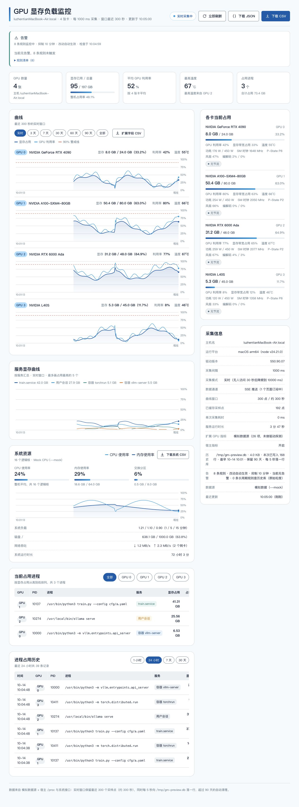

# GPU 显存负载监控

一台机器、多张显卡的显存负载实时看板。零依赖：只用 Node 内置模块 + `nvidia-smi`，不需要 `npm install`。直接在宿主上跑（脚本或 systemd）最省事；不想在宿主装 Node 也可以用仓库自带的 [Docker 编排](#用-docker-跑可选)。



## 功能

- **两种展示模式，随时切换**：顶部「单页 / 导航」开关。**单页**把全部卡片一屏铺开，看趋势、对状态方便对照；**导航**按用途分成「总览 / 曲线 / 进程 / 系统」四个页签，每页一到两张卡，排查问题时不用滚好几屏。切换状态记在 URL（可分享、刷新保持）和浏览器本地存储里，下次打开还是上次那个。**告警面板和整机概览在任何一页都常驻**——切到别的页也看得见出没出事
- **导航模式走紧凑顶栏**：常驻区在 720px 高的窗口里原本要占掉 511px（内容只剩 209px 可见），导航模式把它们各自压成一两行——页头标题与副标题并成一行、告警没触发时压成一条、KPI 五格并成一条横排（脚注改用短文案，完整说法在悬停提示里），首屏内容起点降到 269px；**有告警触发时告警面板自动回弹成展开样式**，该醒目就得醒目。页签栏同时改成粘在窗口顶上，滚到页面中段也能直接切页。单页模式不受影响，一个像素都没改（紧凑规则全部挂在 `.app[data-dense="1"]` 下，只有导航模式加这个属性）
- 同一套紧凑规则也管到「各卡当前占用」：8 张卡平铺时每一行间距都要乘 8，所以行距与字号一起收紧；**一切正常时「无节流」并进硬件健康行尾**（`ECC 无错误 · 无节流`），不再单占一行——真在降频、或驱动根本没给节流字段时，仍然单独成行、带色显示。单张卡从 180px 降到 133px，8 卡从约 790px 降到约 575px
- 一机多卡实时曲线：每张卡一条「显存占用」曲线 + 一条「GPU 利用率」曲线。窗口是 `--window` 个点（默认 300）× `--interval`，**所以它表示多长时间取决于采集间隔**——1 秒间隔是 5 分钟，3 秒间隔就是 15 分钟。服务重启会清空这个内存窗口，但页面**开页时会自动从历史库把前面那段补出来**（重采样成当前采集间隔，断档处如实断开），不用干等一整个窗口才有形状
- **服务显存曲线**：把占卡进程按服务（容器 / systemd 单元 / 用户会话）汇总成一条曲线，最多画占用最高的 5 个、其余并入「其他」。一张卡被多个服务共用时，这张图能回答"是谁在什么时候把显存吃上去的"，比整卡百分比有用得多
- 当前占用：整机显存已用/总量、平均利用率、最高温度，以及每张卡的进度条明细。其中**「平均 GPU 利用率」是跨时间的**——服务端把历史库里近 1 小时的采样点整体平均好送过来（跨时间、跨卡），回答的是"这一小时忙不忙"而不是"此刻忙不忙"；历史库还没攒满一小时时脚注会如实写「近 1 小时未满 · 实为最近 N 分钟」，没有历史库时退回这一帧的跨卡平均并标注「无历史库」
- 占用进程列表：PID / 进程名 / **服务归属** / 显存占用 / 占该卡比例，可按 GPU 过滤（点右上角的 chip）
- 进程占用历史：按"进程身份变化 + 每 5 分钟快照"留档，可以回答"谁在什么时候占上了哪张卡"（可选 1 小时 / 24 小时 / 7 天 / 30 天）。一次画 50 条、按「加载更多」往下翻，另有「占用下限」快捷筛选（≥ 512 MiB / 1 GiB / 4 GiB）——**筛选只影响显示，库里一条都不少**。这张表不跟实时帧走：页面会盯着进程身份有没有变，一变就自动重载（约 10 秒内），所以新起来的进程不用手动刷新就会出现
- 显卡运行状态：SM / 显存时钟、P-State、风扇转速、编解码占用，以及**节流原因**（功耗墙、温度墙、硬件降速…）。这一栏能回答"这张卡是真忙还是在降频"，驱动不支持的字段会自动隐藏
- **显存纠错（ECC）**：可纠正 / 不可纠正错误各分「本次驱动加载以来」与「终身累计」两个计数。单看数字没意义，要看的是**有没有在涨**——所以两个计数都摆出来，本次新增会单独标出。不可纠正错误意味着已经在丢数据，用最重的配色；驱动不提供这些字段时整行隐藏
- **行重映射（Row Remapper）**：显存某一行错误太多时，固件会用备用行顶替它——这既是自愈，也是"这块显存确实坏了一部分"的实锤。只在有情况时才补进那一行（有重映射待生效 / 已重映射过 N 行 / **重映射失败**），健康时不占地方。重映射失败意味着备用行也不够了，是换卡依据
- **XID**：驱动打在内核日志里的 GPU 错误事件（48 双比特 ECC、64 重映射记录失败、79 掉出 PCIe 总线…），相当于显卡的黑匣子。需要读内核日志，因此涉及权限，详见下面的「硬件健康」一节
- 宿主系统资源：CPU 使用率、内存使用率、交换分区、系统负载、磁盘容量、网络吞吐，CPU 与内存单独一条曲线
- **导出**：页面上只有顶部一个「导出」按钮，点开弹窗选**内容**（GPU 曲线 / 宿主指标 / 进程占用历史 / 当前完整快照）、**时间范围**（默认跟随曲线，也可以在这里单独选，不用先去改曲线）和**选项**（是否带扩展指标）。每选一项都会写明导出的是什么、每行代表什么、什么格式、需要什么前置条件——避免同一份数据散在好几处按钮上、各自默认的范围还不一样
- 历史存档：按 SQLite 落库（`data/gpu-monitor.db`），重启不丢；页面顶部可切 实时 / 3 天 / 7 天 / 30 天 / 60 天 / 90 天 / 全部，导出会跟着当前选择走（切到历史区间时曲线是历史值，顶部指标与右侧卡片仍是当前实时值，界面上会标注清楚）
- 实时推送：默认用 SSE 把每一帧推给浏览器，比轮询更省；推送不可用时自动退回轮询（`--no-push` 可强制关掉）
- 告警：显存 / 温度 / 节流 / 利用率 / 宿主内存 / 磁盘 / 采集中断都能配阈值，还能**按服务**（哪个容器、哪个 systemd 单元占了多少）单独设规则；**硬件健康类**（ECC、行重映射、XID）同样能配；支持"持续多久才算触发"和冷却抑制；通知渠道内置**邮件**、Webhook 和控制台日志
- 90% 警戒线、≥90% 与高温的配色告警，异常时给出可复制的排查命令
- 跨平台：同一份代码在 Linux / Windows 上自动探测 `nvidia-smi`，macOS 上明确提示"平台不支持"而不是笼统报错
- 空闲降频：页面关掉之后自动把采集间隔放慢（默认 30 秒无人访问后降到 10 秒），窗口保持连续、回来时曲线不断档

## 平台支持

启动时会自动判断当前系统与硬件环境，`nvidia-smi` 的探测顺序是：`--nvidia-smi` 指定 → `PATH` → 各平台常见安装位置。

| 平台 | 支持情况 | 采集方式 |
| --- | --- | --- |
| Linux | ✅ 完整支持 | `nvidia-smi`（`PATH`、`/usr/bin`、`/usr/local/bin`，也自动识别 WSL2 的 `/usr/lib/wsl/lib`） |
| Windows | ✅ 完整支持 | `nvidia-smi.exe`（`PATH`、`C:\Windows\System32`、`C:\Program Files\NVIDIA Corporation\NVSMI`） |
| macOS | ❌ 不适用 | NVIDIA 官方驱动已停止支持，系统里没有 `nvidia-smi`；页面会明确提示，服务本身能正常启动 |

当前只支持 NVIDIA。AMD（`rocm-smi`）、Intel（`xpu-smi`）尚未实现，探测层预留了扩展位置。

最新版的 GPU 指标（时钟 / P-State / 风扇 / PCIe / 编解码 / 节流原因 / **ECC 错误计数**）是**扩展字段**：不同驱动版本支持程度不一样，服务启动时会逐个探测，不支持的自动跳过并在页面「采集信息 → 扩展 GPU 指标」里说明。用 `--no-extended` 可以整个关掉，只保留基础指标。

### 宿主指标的可用范围

宿主指标来自 Node 内置能力加 Linux 的 `/proc`，取不到的字段会明确写「当前平台不支持」，不会用 0 冒充：

| 指标 | Linux | Windows | macOS |
| --- | --- | --- | --- |
| CPU 使用率 | ✅ | ✅ | ✅ |
| 内存使用率 | ✅（`/proc/meminfo`，用 `MemAvailable` 算已用） | ✅ | ✅ |
| 交换分区 | ✅ | ❌ | ❌ |
| 系统负载 | ✅ | ❌（Windows 没有 loadavg 语义） | ✅ |
| 磁盘容量 | ✅ | ✅（默认系统盘，可用 `--disk` 追加） | ✅ |
| 网络吞吐 | ✅（`/proc/net/dev`） | ❌ | ❌ |
| 系统运行时长 | ✅ | ✅ | ✅ |

Windows 上没有内置的网卡字节数与交换分区数据源，这两项会显示为「当前平台不支持」。macOS 上内存用系统接口取值，`free` 的统计口径与 Linux 不同，数字会偏保守。

### 历史库

历史存在 SQLite 里，用的是 Node 22.13+ 默认提供的 `node:sqlite`，**依然不需要 `npm install`**。Node 版本低于 22.13（`node:sqlite` 在 22.5 才首次引入，而且直到 22.13 都还要额外加 `--experimental-sqlite` 参数）或者带了 `--no-db` 时，服务照常运行，只是页面会明确写「未启用历史库」，`/api/history?range=…` 会退回内存窗口并说明原因。

### 进程的「服务归属」是怎么来的

「当前占用进程」和「进程占用历史」两张表里都有一列**服务**，按这个顺序判断（Linux 上读 `/proc`，其它平台留空）：

1. **容器** —— 读 `/proc/<pid>/cgroup` 拿到容器 ID。这是共享机器上最有用的那一级：像 vLLM 会把进程标题改写成 `VLLM::EngineCore`，光看命令行根本分不出是哪个服务，但 cgroup 里的容器 ID 能唯一确定它属于哪个容器。
2. **systemd 单元** —— 例如 `train.service`。
3. **用户会话** —— 从终端/IDE 直接跑起来的进程（`session-N.scope`、`user@1000.service`）。
4. 都不是就留一个 `–`，不编造服务名。

鼠标悬停在服务那一格上会显示**运行用户**和**完整命令行**——判断"这个进程能不能动"时通常最需要这两条信息。

两个需要知道的限制：

- **容器名需要一点权限**。容器 ID 谁都能读，但从 ID 反查容器名要读 `/var/lib/docker/containers/<id>/config.v2.json`（root）或调 `docker inspect`（在 docker 组里）。拿不到名字时会显示**容器 ID 的前 12 位**——同一个容器的进程仍然会显示同一个值，你拿它跟 `docker ps` 一对比就知道是哪个容器。用 root 跑服务（systemd 模板默认就是）时名字会自动出来。
- **`/proc` 读不到就留空**。某些加固内核设了 `hidepid`，或进程属于你无权查看的用户时，这一列会是 `–`；采集本身不受影响。

想确认这台机器能解析到什么程度，随便挑一个占卡进程试一下：

```bash
p=<一个占卡的 PID>
head -1 /proc/$p/cgroup          # 有 docker-...scope 就说明是容器
stat -c '%U' /proc/$p            # 运行用户
tr '\0' ' ' < /proc/$p/cmdline   # 完整命令行
```

两个刻意的设计：

- **落库粒度与页面刷新解耦**：屏幕上看 1 秒粒度（`--interval`），库里按 `--store-interval`（默认 5 秒）抽稀。体积差 5 倍，历史趋势几乎无损失。
- **进程按事件留档**：只在进程身份变化时写一行（相当于"谁在什么时候占上了卡"），另外每 5 分钟补一次快照，不再逐采样点刷重复行。

- **默认永久保留**：历史留着才翻得回去，而按天清理是静默的数据丢失，所以默认不清。要给个上限就加 `--retention-days <天>`（超过的行会在启动时和之后每小时清一次）。

体积参考：单卡 5 秒粒度约 7 MiB/天，一年 2.5 GiB；8 张卡一年约 20 GiB。实际大小在页面「采集信息 → 历史库」里能看到，嫌大就调大 `--store-interval`。

#### 库文件的长期维护

新建的库默认开启 SQLite 的**增量回收**：每小时清理过期数据时，会把释放出来的页还给文件系统，同时截断 WAL 日志。所以给了 `--retention-days` 之后，稳态运行（写入速率恒定、保留期固定）下文件大小会自己稳定下来，不需要额外操作。默认的永久保留模式下没有"过期数据"可清，文件就是随数据一直长。

需要手动处理的是"水位变化"的情况——调大了 `--store-interval`，或者给 `--retention-days` 设了天数后又改小。这时文件会停在历史最高水位，删掉的空间不会自动还回来：

```bash
node tools/db-maintenance.mjs            # 看状态：数据范围、文件大小、可回收空间、回收是否开启
node tools/db-maintenance.mjs --prune --retention-days 30   # 清一次 30 天前的数据（不给天数不会删任何行）
node tools/db-maintenance.mjs --reclaim  # 整库重写，把可回收空间还给文件系统
```

`--reclaim` 会重写整个文件，大库需要一点时间和等量磁盘空间，建议放在维护窗口做。也可以直接用 `node server.js --reclaim` 在启动时做一次同样的重写。页面「采集信息 → 历史库」里可回收空间超过 32 MB 时会把它标出来。

### 告警

告警规则和通知渠道都写在同一个配置文件里，从示例复制一份开始：

```bash
cp alerts.example.json alerts.json
${EDITOR:-vi} alerts.json     # 改 SMTP 地址与收件人
./start-bg.sh                 # 服务启动时会自动读取 alerts.json
```

规则长这样：

```json
{ "id": "vram-high", "metric": "memUsedPct", "op": ">=", "threshold": 90, "for": "2m", "level": "warning" }
```

- `for`：条件要**持续**满足这么久才算触发，避免瞬时抖动就发信；单位 `s` / `m` / `h`，纯数字按秒算
- `cooldown`（写在配置顶层，默认 10 分钟）：同一条告警在这段时间内不重复通知
- `historyCache`（写在配置顶层，默认 30 秒）：长周期规则查历史库的缓存周期
- `minSamples`（可选，默认 2）：判定"持续满足"至少要看几个采样点；`for` 比采集间隔还短时会自动放宽到 1 个，避免规则时灵时不灵
- `level`：`warning` 或 `critical`，只影响文案与邮件主题

可用的 `metric`：

| 指标 | 范围 | 说明 |
| --- | --- | --- |
| `memUsedPct` / `memUsedMiB` | 每张卡 | 显存占用率 / 占用容量 |
| `utilGpuPct` / `utilMemPct` | 每张卡 | GPU 利用率 / 显存带宽占用 |
| `tempC` / `powerW` | 每张卡 | 温度 / 功耗 |
| `throttled` | 每张卡 | 布尔值，`{"op": "==", "value": true}` 表示"出现任何节流原因" |
| `hostCpuPct` / `hostMemUsedPct` / `hostSwapUsedPct` / `hostDiskUsedPct` | 整机 | 宿主指标，磁盘取所有挂载点里最满的那个 |
| `serviceMemMiB` | 每个服务 | 该服务占用的显存合计（服务 = 容器 / systemd 单元 / 用户会话，见上面的「服务归属」） |
| `serviceSharePct` | 每个服务 | 该服务占用占整机显存总量的比例（多张卡时按各卡总量之和算） |
| `eccCorrectedAggregate` / `eccUncorrectedAggregate` | 每张卡 | 显存纠错计数（终身累计）；看趋势，不看单点 |
| `eccUncorrectedVolatile` | 每张卡 | 本次驱动加载以来的不可纠正错误数，适合配"出现就告警" |
| `xidRecent` / `xidCount` | 每张卡 | XID 错误数：最近 30 分钟 / 累计。**规则用 `xidRecent`**——累计值只涨，一旦触发就永远恢复不了 |
| `remapPending` / `remapFailure` | 每张卡 | 布尔值，行重映射"有待生效" / "失败"（失败是换卡依据） |
| `collectOk` | 服务 | 布尔值，`{"value": false}` 表示采集中断（至少持续 30 秒才触发） |

硬件健康类指标（ECC / XID / 行重映射）在**读不到数据时不会触发**——比如驱动不提供 ECC 字段、或没权限读内核日志拿到 XID。把"读不到"当成"没问题"是监控里最危险的错误，所以这里一律按"未知 = 不告警"处理，页面的「采集信息」里会写明读不到的原因。

几个现成的规则写法：

```json
{ "id": "ecc-uncorrected", "metric": "eccUncorrectedVolatile", "op": ">=", "threshold": 1,
  "for": "0s", "level": "critical", "label": "出现不可纠正的显存错误" }
{ "id": "remap-failure", "metric": "remapFailure", "op": "==", "value": true,
  "for": "0s", "level": "critical", "label": "行重映射失败（备用行不够用）" }
{ "id": "xid-any", "metric": "xidRecent", "op": ">=", "threshold": 1,
  "for": "0s", "level": "warning", "label": "出现 XID 错误" }
{ "id": "ecc-trend", "metric": "eccCorrectedAggregate", "op": ">=", "threshold": 100,
  "for": "0s", "level": "warning", "label": "可纠正错误累计过百（显存在退化）" }
```

**一张卡被多个服务共享时，服务维度的规则比整卡阈值有用得多。** 整卡只能告诉你"这张卡快满了"，服务维度能告诉你"是谁快把卡吃满了"：

```json
{ "id": "vllm-embed-vram", "metric": "serviceMemMiB", "service": "vllm-embed",
  "op": ">=", "threshold": 10240, "for": "2m", "level": "warning" }
```

- `service` 是**子串匹配**（不区分大小写）：写 `vllm-embed` 能匹配到「容器 vllm-embed」，写 `用户会话` 能匹配到所有从终端直接跑起来的进程。
- **不写 `service`** 就会对每个服务各判一次，适合"任何服务超过 20 GB 都要提醒我"这种兜底规则。
- 服务中途消失（容器停了）时按 0 处理，所以"占用过高"的告警会**自动恢复**，不会停在上一次的值上一直响。
- 判定"是哪个服务"依赖 `/proc`（也就是上面「服务归属」那一节说的容器 / systemd / 会话），所以这一维度和「服务」列一样有 `–` 的情况——归到「未识别」的那个桶里，也能对它设规则。

服务维度的值会跟着每个采样点落库，所以 `for` 一样能配到几分钟甚至更长（没有历史库时受内存窗口限制，与其它指标一致）。

几个使用要点：

- **`for` 超过内存窗口时会自动改查历史库**。默认内存窗口是 300 点 × 1 秒 = 5 分钟；配 `for: 30m` 这类长周期规则时，引擎会从历史库里取这段时间的数据判定（多条长周期规则共用一次查询，默认每 30 秒刷新缓存）。只有在**没有历史库**时（`--no-db`，或 Node 低于 22.13）才会退回"夹到窗口长度"，启动日志与页面都会明确提示。
- **历史数据点数过多时会按桶平均**。查回来的区间超过约 2000 个点（按默认 5 秒落库粒度约合 2.8 小时以上）会自动分桶，平均会抹平短于桶宽的尖峰。10 分钟、30 分钟这类常用规则用的都是原始粒度，不受影响；页面「采集信息 → 告警」里会标明当前是按原始粒度还是分桶判定。
- **抗抖动**：冷却期内不会重复通知，**包括"刚恢复又马上触发"的情况**；并且只有真的发出过"告警"，恢复正常时才会补一条"恢复"，不会出现没告警却收到恢复的怪邮件。
- **覆盖不足会明说**：如果拿到数据的时间跨度不够规则要求的 `for`（比如服务刚上线、库里历史还不够长），告警照发，但文案会写成"仅覆盖 12 秒，不足规则要求的 5 分钟"，不会假装已经持续了那么久。
- **密码建议放环境变量**：配置里支持 `${SMTP_PASS}` 这种占位符，写法是 `"pass": "${SMTP_PASS}"`，启动前 export 一下即可，不用把密码写进文件。若确实要写在文件里，记得 `chmod 600 alerts.json`。
- **改完配置不用重启**：`alerts.json` 一保存就自动重新加载（监听目录，所以编辑器"写临时文件再改名"的保存方式也能识别）。**配置写坏时不会把告警弄丢**——沿用上一次可用的规则，并在日志和页面「采集信息 → 告警」里写明原因；监控系统最怕的就是自己悄悄失效。想关掉热加载用 `--no-alerts-reload`。

先确认规则能不能触发、会发什么内容，用 `--alerts-dry-run`：只打印"本来要发什么"，不真的连 SMTP。

### 硬件健康：ECC / 行重映射 / XID

性能指标回答"这张卡忙不忙"，这三样回答的是**"这张卡是不是在变坏"**——推理卡长期高负载跑，显存老化是真实风险，而这几项出事时通常先表现为"任务莫名其妙报 CUDA 错误"，看性能曲线完全看不出来。

| 指标 | 是什么 | 怎么看 |
| --- | --- | --- |
| **ECC 可纠正** | 单比特错误，硬件自己纠了，程序无感 | 单个不危险，**危险的是增长速率** |
| **ECC 不可纠正** | 双比特错误，纠不回来 | 正在跑的任务可能拿到错误数据，要立刻处理 |
| **行重映射** | 某一行错误太多，固件用备用行顶替它 | 每重映射一次就是"这块显存确实坏了一部分"的实锤；**重映射失败 = 备用行也不够了，换卡依据** |
| **XID** | 驱动打在内核日志里的错误编号 | 编号跨度极大：63 只是记录了一次重映射，79 是 GPU 掉出 PCIe 总线 |

界面上这些信息在「各卡当前占用」每张卡的最后一行，**只在有情况时出现**（健康的那张卡不会写一堆 0）。ECC 的计数分两个尺度：`volatile` 是本次驱动加载以来、`aggregate` 是终身累计——判断"现在是不是在变坏"看前者。

**XID 需要读内核日志，因此要权限。** Ubuntu 默认 `kernel.dmesg_restrict=1`，非 root 读不到 `dmesg`。服务会按 `dmesg` → `journalctl -k` 的顺序尝试，都失败就在页面「采集信息 → XID 日志」里写明原因（**而不是显示 0 次**——"读不到"和"没有错误"是两回事，把前者当成后者是监控里最危险的错误）。想让它工作，选一条：

- 用 root 运行服务（`deploy/` 里的 systemd 模板默认就是 root，顺带也能看全占用进程）
- 把运行用户加进 `systemd-journal` 组，改走 `journalctl`
- 给 node 二进制加读日志的 capability：`sudo setcap cap_syslog+ep /opt/node24/bin/node`

想知道某台机器能不能读，跑这三条就行：

```bash
journalctl -k --no-pager -o short-iso -n 3 2>/tmp/je.txt | tail -3
cat /tmp/je.txt     # 出现 "not seeing messages" 之类的 Hint，说明只能看到部分日志
id                  # 有 adm 或 systemd-journal 组即可
```

实测：运行用户在 **`adm`** 组里时 `journalctl -k` 就能拿到完整内核日志（stderr 为空），不必换成 root。反过来，`journalctl` 在权限不足时会**退出码 0 却只给部分日志**——所以服务会识别那句 Hint 并当作"读不到"，否则就会把"看不到"显示成"累计 0 条"。

XID 的累计计数由服务自己维护：内核日志会轮转、重启就清空，所以不能每次只读当前缓冲。

## 快速开始

```bash
cd gpu-monitor

# 先体检一遍：Node 版本、nvidia-smi、驱动支持的扩展字段、宿主指标、磁盘空间、端口
node tools/preflight.mjs

# 有 GPU 的机器
./start-bg.sh

# 没有 GPU 的机器上先看效果（模拟数据）
./start-bg.sh --mock
```

打开 `http://<机器IP>:8090` 即可，停止用 `./stop.sh`。也可以直接 `node server.js --port 8090` 前台跑，效果一样。

### 部署前自检

`node tools/preflight.mjs` 会把"这台机器能不能跑、能跑成什么样"先体检一遍。它只读为主——不会建库、不会改配置，只在判断端口占用时临时绑定一下再立刻释放。最后给出结论与建议的启动命令，有阻塞项时退出码为 1，可以直接接进部署脚本。

```bash
node tools/preflight.mjs
node tools/preflight.mjs --port 8090 --db /opt/gpu-monitor/data/gpu-monitor.db
node tools/preflight.mjs --nvidia-smi /usr/local/bin/nvidia-smi   # 手动指定采集命令
```

检查项：Node 版本够不够开历史库、`nvidia-smi` 在不在、**这台机器的驱动支持哪些扩展字段**（不支持的逐条列出）、显卡与占用进程能否读到、宿主 CPU/内存/磁盘/网络哪些可用、历史库目录与剩余空间（按卡数估算一年体积）、告警配置有没有问题、端口是否被占用。

Windows 上没有 shell 脚本（`.sh` 在 Windows 上跑不了），直接在终端启动：

```powershell
node server.js --port 8090

# 需要后台常驻（关掉终端不退出）
Start-Process -WindowStyle Hidden node -ArgumentList "server.js","--port","8090"
```

停止时用任务管理器结束 node 进程，或 `taskkill /F /IM node.exe`（注意会结束所有 node 进程）。

## 部署到服务器

```bash
# 1. 把 gpu-monitor 目录拷到服务器（scp / rsync 都行）
scp -r gpu-monitor user@server:/opt/

# 2. 在服务器上启动（前台跑，Ctrl+C 退出）
cd /opt/gpu-monitor
node server.js --port 8090
```

默认监听 `0.0.0.0`，局域网内用 `http://<服务器IP>:8090` 访问。

### Node 版本与升级（不动服务器上的其他项目）

两条底线：

- **Node 18+** 就能跑，实时监控、曲线、告警都正常；
- **Node 22.13+** 才有内置的 `node:sqlite`，才有历史库、长时间范围曲线、进程占用历史和长周期告警。

推荐**旁装**：把新版 Node 解到 `/opt` 单独给本项目用，完全不碰系统里的 `node`，因此对服务器上其他项目零影响。

```bash
# 0. 先看清现状：当前 node 在哪、是谁装的
which -a node && node -v
readlink -f "$(command -v node)"
dpkg -S "$(readlink -f "$(command -v node)")" 2>/dev/null || echo "不是 apt/dpkg 装的"

# 1. 下载官方二进制（x86_64；ARM 机器把 linux-x64 换成 linux-arm64）
#    国内网络慢就把域名换成 https://npmmirror.com/mirrors/node/
cd /tmp
curl -fsSLO https://nodejs.org/dist/v24.21.0/node-v24.21.0-linux-x64.tar.xz

# 2. 装到 /opt/node24，与系统 node 完全隔离
sudo mkdir -p /opt/node24
sudo tar -xJf node-v24.21.0-linux-x64.tar.xz -C /opt/node24 --strip-components=1
/opt/node24/bin/node -v          # 应输出 v24.21.0

# 3. 让 gpu-monitor 用这个 node 启动，系统 node 保持原样
SMTP_PASS=... ./start-bg.sh --node /opt/node24/bin/node
```

`--node` 也可以写成环境变量：`NODE_BIN=/opt/node24/bin/node ./start-bg.sh`。启动横幅第一行会打印实际用的 node 路径，重启后核对一下即可。换成 systemd 常驻时，把单元里 `ExecStart=` 的 node 路径一并改掉（见 [deploy/gpu-monitor.service](deploy/gpu-monitor.service)）。

**为什么不直接把系统 node 升级掉？** 那是一次全局替换，会波及服务器上所有用 node 的东西：

| 影响面 | 怎么确认 |
| --- | --- |
| pm2 / forever 托管的应用会被新 node 重新拉起 | `pm2 list`、`which pm2` |
| systemd 单元里写死 node 路径的服务 | `systemctl list-units --type=service`，再筛 node |
| 编译过原生模块的项目（node-gyp、better-sqlite3 之类），Node ABI 一换就得重装依赖 | 项目里有没有 `node_modules` 下的 `.node` 文件 |
| 依赖旧 Node 行为的老构建链（老 webpack、node-sass…） | 各项目自己的构建 |

盘点一下现在到底有哪些 node 在跑：

```bash
ps -eo user,pid,cmd | grep -i '[n]ode'
```

确认没人依赖之后，再考虑原地升级。不同安装方式的升级手法不一样：`apt` 装的（Ubuntu 24.04 自带的 18.19.1 就是）通常要换 NodeSource 源再 `sudo apt-get install -y nodejs`，替换的是 `/usr/bin/node`，影响全局；`nvm` 装的用 `nvm install 24 && nvm alias default 24`，只影响 source 过 nvm 的交互式 shell，systemd 服务不受影响。

还有一点要有预期：**换上带 `node:sqlite` 的 Node 之后，历史库是从零开始攒的**，刚切过去时「3 天 / 7 天 / 30 天」这些区间只有从切换那一刻起的数据。

### 时区（导出的时间差几小时，就查这里）

云主机的系统时区默认常常是 **UTC**（`ls -l /etc/localtime` 会看到 `-> /usr/share/zoneinfo/Etc/UTC`），而用页面的人在东八区。这时导出的 `time_local` 会和 `timestamp_iso` 一模一样——看着像"修复没生效"，其实是这台机器的本地时间本来就是 UTC。

```bash
# 先确认是哪种情况
date '+%Z %z'
node -e 'console.log(Intl.DateTimeFormat().resolvedOptions().timeZone)'
```

要固定成本地时间，推荐一次性写进配置文件（后面不用再管）：

```bash
cd /opt/gpu-monitor
cp gpu-monitor.conf.example gpu-monitor.conf
echo 'TZ=Asia/Shanghai' >> gpu-monitor.conf
chmod 600 gpu-monitor.conf          # 里面可能还有邮箱密码
```

之后 `./start-bg.sh --node /opt/node24/bin/node` 不带任何参数就是东八区。临时想换一种（比如排查问题时按 UTC 看一遍）也没问题，显式给的永远优先：

```bash
TZ=UTC ./start-bg.sh                # 这一次按 UTC 跑，不改配置文件
```

也可以单次直接给：

```bash
SMTP_PASS='你的授权码' ./start-bg.sh --node /opt/node24/bin/node --tz Asia/Shanghai
```

它**只改 gpu-monitor 这个进程的时区**：导出里的 `time_local`、CSV 文件名里的时间戳、日志时间都会跟着走。系统时区一个字节都不动，所以**这台机器上跑着的其他服务完全不受影响**——这也是为什么不要用 `sudo timedatectl set-timezone Asia/Shanghai` 去改：那会波及所有依赖 UTC 的服务（数据库、日志、调度器），改完才发现就晚了。

等价写法有三种，任选其一：

| 方式 | 写法 | 适用 |
| --- | --- | --- |
| 配置文件 | `gpu-monitor.conf` 里写一行 `TZ=Asia/Shanghai` | **一次配好，以后启动不用带参数**，见下面「本机部署配置」 |
| 启动参数 | `./start-bg.sh --tz Asia/Shanghai` | 临时或单次使用最直观 |
| 环境变量 | `TZ=Asia/Shanghai ./start-bg.sh` | Node 原生支持，写进自己的重启脚本也方便 |
| systemd | 单元里加 `Environment=TZ=Asia/Shanghai` | 走 systemd 托管时用（模板里有注释示例） |

启动横幅和页面上的导出弹窗都会写明**当前生效的时区**；如果时区还是 UTC 且没有显式固定，启动横幅会直接提示该怎么改——不会让你自己去猜为什么时间对不上。

## 启动脚本

项目根目录自带三个脚本，参数和 `server.js` 完全一致：

| 脚本 | 作用 |
| --- | --- |
| `./start.sh` | 前台启动，日志直接打在终端，`Ctrl+C` 结束 |
| `./start-bg.sh` | 后台启动（nohup），PID 写入 `.run/gpu-monitor.pid`，日志追加到 `gpu-monitor.log` |
| `./stop.sh` | 停止后台服务，先 SIGTERM 优雅退出，10 秒内没退出再 SIGKILL |

```bash
./start-bg.sh                                 # 默认 8090
./start-bg.sh --port 8081                     # 换端口
NODE_BIN=/usr/local/bin/node ./start-bg.sh    # 指定 node 路径
tail -f gpu-monitor.log                       # 实时看日志
./stop.sh                                     # 停止
```

脚本的默认端口是 **8090**（`server.js` 自身默认还是 8080，脚本会显式传 `--port`，所以以 8090 为准）。

上传后如果可执行位丢了，先 `chmod +x *.sh`，或者用 `bash start-bg.sh` 直接跑。脚本会自己检查 node 是否存在及版本、端口是否被占用、服务是否已在运行、PID 文件是否过期，出问题会直接给中文提示。端口检查是直接让 node 试绑一次端口，被占用时**立即中止启动**（不会把服务拉起来），并打印占用端口的进程和可换的端口号。

### 本机部署配置（gpu-monitor.conf）

放"只属于这台机器"的值：时区、邮箱密码、端口、node 路径。项目根目录的 `gpu-monitor.conf` **不进版本库**（模板是 `gpu-monitor.conf.example`），所以每台机器各配一份，`git pull` 不会互相覆盖、也不会把密码提交上去。

```bash
cd /opt/gpu-monitor
cp gpu-monitor.conf.example gpu-monitor.conf
chmod 600 gpu-monitor.conf
$EDITOR gpu-monitor.conf
```

文件就是普通的 `KEY=VALUE` 行，`#` 开头是整行注释。常用几项：

| 键 | 作用 |
| --- | --- |
| `TZ` | 固定本服务时区，导出时间列 / CSV 文件名 / 日志时间都跟着走（见「部署到服务器 → 时区」） |
| `SMTP_PASS` | 告警邮件密码。`alerts.json` 里写 `${SMTP_PASS}` 占位，值放这里，就不必每次启动都在命令行上带一遍 |
| `PORT` / `INTERVAL` / `WINDOW` | 等价于同名启动参数的默认值 |
| `NODE_BIN` | 指定 node 路径，等价于 `--node` |

**优先级**：命令行/环境里显式给的 **>** 配置文件 **>** 内置默认。所以 `PORT=9000 ./start-bg.sh` 一定覆盖配置文件里的 `PORT`，排查问题时不会被"藏起来的默认值"绊住。

两点说明：

- 只有 `./start-bg.sh` / `./start.sh` 会读它。直接 `node server.js` 时不读——那种用法请用 `--tz` 或 `TZ=` 环境变量。
- 想临时指到别处的配置，用 `GPU_MONITOR_CONF=/path/to/other.conf ./start-bg.sh`。

### 开机自启（systemd，可选）

脚本方式能扛住 SSH 断开，但机器重启后不会自己起来。仓库里带了单元模板 [deploy/gpu-monitor.service](deploy/gpu-monitor.service)：

```bash
sudo cp deploy/gpu-monitor.service /etc/systemd/system/
sudoedit /etc/systemd/system/gpu-monitor.service    # 按注释里标【改】的地方调整路径
sudo systemctl daemon-reload
sudo systemctl enable --now gpu-monitor
journalctl -u gpu-monitor -f
```

模板里已经处理好的几件事：

- **默认用 root 运行**：`nvidia-smi` 只能看到同一用户的占用进程，换成专用用户后页面上的进程列表会是空的。想最小权限就改成与业务进程相同的用户，效果一样。
- **邮件密码走环境文件**（`EnvironmentFile=-/etc/gpu-monitor.env`），不必写进 `alerts.json`；配了 `${SMTP_PASS}` 占位就必须提供这个变量，否则邮件发不出去。
- **停止时会把缓冲区落盘**（`KillSignal=SIGTERM` + `TimeoutStopSec=15`），不会丢最后几秒的数据。
- 附带了基础加固（`ProtectSystem=full`、`ProtectHome=read-only` 等）；历史库若放在别处，按注释放开 `ReadWritePaths`。

> 手动启动过的话，先用 `./stop.sh` 停掉再交给 systemd，避免两边抢同一个端口。

### 用 Docker 跑（可选）

不想在宿主上装 Node、或者希望"升级 = 改挂载 + 重启容器"，可以用仓库自带的编排。镜像里只有运行时底座（Node 24 + `dmesg` + 时区数据），**代码不打进镜像**、从宿主只读挂载，所以 `git pull` 后 `docker compose restart` 就生效，不需要重建。

```bash
cp .env.example .env        # 填 SMTP_PASS；8 卡机器再加 INTERVAL=3000
docker compose up -d --build
docker compose logs -f
docker compose exec gpu-monitor node tools/notify-test.mjs     # 验邮件通道
```

难点只有一个：**这个看板的工作是"看透宿主"，所以容器拿到的权限比一般容器多**，`docker-compose.yml` 里逐条写了各自为了什么：

| 配置 | 为了什么 |
| --- | --- |
| `pid: host` | 占用进程表与「服务归属」要读宿主 `/proc/<pid>`；少了它，nvidia-smi 报的是宿主 PID，容器里找不到 |
| `uts: host` | 主机名用宿主的。容器默认的 hostname 是容器 ID，会被当成"主机标识"写进页面和历史库，重建容器还会变一次 |
| `network_mode: host` | 直接监听宿主 8090，行为和脚本方式一致（反代 / SSE 都不受影响） |
| `cap_add: [SYSLOG]` + `/dev/kmsg` | 读内核日志拿 XID（`kernel.dmesg_restrict=1` 时非 CAP_SYSLOG 读不到） |
| `/etc/passwd`、`/etc/group`、`/var/lib/docker` 只读挂载 | PID → 用户名、容器 ID → 容器名（挂目录而不是 `docker.sock`，不给容器 docker 控制权） |
| `/:/hostfs:ro` + `--disk /hostfs` | 磁盘容量要真实挂载点的 `statfs`；容器自己的 `/` 是 overlay 层，报它没意义 |
| `deploy.reservations.devices` | nvidia-smi 来自宿主驱动，需要 NVIDIA Container Toolkit |

也就是说：这个容器不是隔离沙箱，它和"在宿主上用 root 跑一个服务"的安全边界差不多——真正的边界是"谁能访问 8090"。**顺带一个好处**：XID 不用再单独配权限（容器以 root 跑且带 `CAP_SYSLOG`），systemd 方案里那句 `SupplementaryGroups=adm` 在这里就不需要了。

宿主上的差异（端口 / 采集间隔 / 时区 / 邮件密码 / 监控哪个磁盘）全放 `.env`，不进版本库。历史库仍在宿主 `./data` 下，只是属主会变成 root——**回滚回脚本方式前记得 `sudo chown -R <用户>:<用户组> data`**。

**拉不动基础镜像怎么办（国内很常见）**：`docker compose build` 报 403、超时或 `failed to resolve source metadata`，是镜像源的问题，不是代码的问题。两条路：

1. **换源**：在 `.env` 里写一行，Dockerfile 不用改——
   `BASE_IMAGE=docker.m.daocloud.io/library/node:24-slim`（或 `docker.1panel.live/library/node:24-slim` 等任何能用的源前缀）。
2. **离线包**（一个源都不通时）：在能联网的机器上构建好再拷过去。注意架构要和服务器的 CPU 一致，服务器是 x86_64 就加 `--platform linux/amd64`：

   ```bash
   # 联网的机器上
   docker buildx build --platform linux/amd64 -t gpu-monitor-runtime:latest --load .
   docker save gpu-monitor-runtime:latest | gzip > gpu-monitor-runtime.tar.gz
   # 目标服务器上
   gunzip -c gpu-monitor-runtime.tar.gz | docker load
   docker compose up -d          # 本地已有镜像，不会再联网
   ```

### 健康检查

`GET /api/health` 返回 `200`（健康，或只有提醒）或 `503`（有致命项），body 里逐项列出采集、历史库、磁盘、告警的状态：

```bash
curl -s localhost:8090/api/health
curl -s -o /dev/null -w '%{http_code}\n' localhost:8090/api/health
```

它判定的是"服务本身还能不能干活"——采集是否新鲜（阈值会跟着空闲降频自动放宽）、历史库是否可写、磁盘还剩多少；显存高、温度高这类业务告警只作为信息回报，不会让服务变成不健康。探活请求不会打断空闲降频，所以可以放心接到定时探测上（`curl -fsS` 直接接现有监控即可）。

## 启动参数

| 参数 | 默认值 | 说明 |
| --- | --- | --- |
| `--port` / `-p` | `8090` | 监听端口（启动脚本的默认值；直接跑 `server.js` 时默认 8080），也可用环境变量 `PORT` |
| `--host` | `0.0.0.0` | 监听地址，也可用环境变量 `HOST` |
| `--interval` | `1000` | 采集间隔（毫秒） |
| `--window` | `300` | 内存中保留的采样点数，即页面曲线窗口 |
| `--nvidia-smi` | 自动探测 | 手动指定 nvidia-smi；不指定时按平台依次尝试 `PATH` → `/usr/bin` → `/usr/local/bin` → WSL2 → Windows 系统目录，也可用环境变量 `NVIDIA_SMI_BIN` |
| `--disk` | 平台默认 | 额外监控的挂载点，可重复：`--disk / --disk /data`。POSIX 默认 `/`，Windows 默认系统盘 |
| `--no-system` | 关闭 | 关掉宿主 CPU / 内存 / 磁盘 / 网络采集，只留 GPU 指标 |
| `--no-extended` | 关闭 | 关掉扩展 GPU 指标（时钟 / P-State / 风扇 / PCIe / 编解码 / 节流原因） |
| `--db` | `data/gpu-monitor.db` | 历史库文件路径，也可用环境变量 `GPU_MONITOR_DB` |
| `--no-db` | 关闭 | 不落库，只保留内存窗口 |
| `--store-interval` | `5000` | 落库间隔（毫秒），与页面刷新间隔解耦 |
| `--retention-days` | `0` | 历史保留天数；默认 `0` = 永久保留，填天数才按天清理 |
| `--no-store-processes` | 关闭 | 不把占用进程写进历史库 |
| `--proc-min` | `0` | 占用不到这个值（MiB）的进程**不写进**历史库；默认 `0` = 全记。只想看得清爽点请用页面上的「占用下限」，那个不丢数据 |
| `--reclaim` | 关闭 | 启动时把历史库整库重写一次，释放已删数据占用的空间（等价于 `db-maintenance --reclaim`） |
| `--no-push` | 关闭 | 关掉 SSE 推送，页面自动回到轮询 |
| `--alerts` | `alerts.json` | 告警配置文件路径，文件不存在则不启用告警 |
| `--no-alerts` | 关闭 | 不启用告警 |
| `--alerts-dry-run` | 关闭 | 只打印将要发送的通知，不真正发信 |
| `--no-alerts-reload` | 关闭 | 关掉告警配置热加载（默认改了 `alerts.json` 会自动重新加载） |
| `--idle-after` | `30` | 多久（秒）没有页面访问就转入空闲降频，`0` 表示不降频 |
| `--idle-interval` | `10000` | 空闲期间的采集间隔（毫秒） |
| `--tz` | 跟随系统时区 | 把**本服务**的时区固定成这个 IANA 名字（如 `Asia/Shanghai`）。影响导出里的 `time_local` 列、CSV 文件名、日志时间；也认 `TZ` 环境变量。**只对这个进程生效，不改系统时区，不影响这台机器上的其他服务**——详见「部署到服务器 → 时区」 |
| `--mock` | 关闭 | 用模拟数据启动，便于无 GPU 环境联调 |

环境变量：`GPU_MONITOR_MOCK=1` 等价于 `--mock`；`GPU_MONITOR_MOCK_GPUS=8` 指定模拟卡数；`GPU_MONITOR_MOCK_HIGH=1` 让 0 号卡稳定在 90% 以上，用来检查告警配色。

## HTTP 接口

| 路径 | 说明 |
| --- | --- |
| `GET /api/state` | 当前状态：每张卡的显存/利用率/温度/功耗、进程列表、采集元信息 |
| `GET /api/health` | 健康检查：`200` 健康或仅有提醒、`503` 有致命项；探活不会打断空闲降频 |
| `GET /api/stream` | SSE 推送：每采集一帧推一条，内容与 `/api/state` 同构；`--no-push` 时返回 404 |
| `GET /api/history?limit=N` | 内存中的采样窗口，页面打开时用于回填曲线 |
| `GET /api/history?range=7d` | 历史区间（`3d` / `7d` / `30d` / `60d` / `90d` / `all`，或 `from`/`to`、`step`） |
| `GET /api/processes?range=24h&limit=50` | 进程占用事件（谁在什么时候占上了哪张卡），区间写法同 `/api/history`，另返回 `total` 总数。`limit` 一次取多少条（上限 2000），`min` 是**占用下限**（MiB，如 `&min=1024` 只看 ≥ 1 GiB 的），默认取启动参数里的 `--proc-min` |
| `GET /api/export.csv` | 下载曲线原始数据（每行 = 一个采样点 × 一张卡）；加 `&fields=full` 会带上时钟 / P-State / 风扇 / PCIe / 编解码 / 节流等扩展列（需要历史库） |
| `GET /api/export.system.csv` | 下载宿主指标（每行 = 一个采样点；磁盘只导出第一个挂载点，完整明细在 JSON 里） |
| `GET /api/export.processes.csv?range=24h` | 下载进程占用事件（每行 = 一次事件：时间 / 卡 / PID / 进程名 / 占用 / 服务 / 用户）。**必须带时间范围**，不带会返回 400；区间内的事件全部导出，不设条数上限 |
| `GET /api/export.json` | 下载当前完整状态 + 采样窗口 |

`/api/state` 里几个值得单独说明的字段：

- `gpus[]`：每张卡的实时指标。硬件健康相关的在 `eccMode` / `eccCorrectedVolatile` / `eccUncorrectedVolatile` / `eccCorrectedAggregate` / `eccUncorrectedAggregate`，以及 `remap`（`correctable` / `uncorrectable` / `pending` / `failure` / `banksMax`）和 `xid`（`count` / `lastCode` / `lastAt` / `recent`）。**读不到时这几个是 `null` / 缺失，不是 0**——"看不到"和"没有错误"必须能区分
- `services[]`：按服务汇总的显存占用（`service` / `memMiB` / `sharePct` / `processes` / `users[]`）
- `storage`：历史库状态（`mode` / `path` / `written` / `oldestTs` / `retentionDays` / `procMinMiB` …）
- `utilAverage`：近 1 小时的 GPU 利用率均值（`avg` / `samples` / `cards` / `oldestTs` / `newestTs` / `windowMs`），就是概览里「平均 GPU 利用率」那张卡片的数。`avg` 为 `null` 表示算不出来（没有历史库或区间内没有数据），**不是 0%**；`oldestTs` 用来判断这一小时有没有攒满——服务刚部署时 `oldestTs` 距今不足一小时，页面据此标注"实为最近 N 分钟"。服务端每 60 秒重算一次并缓存，不会让每个打开的页面各自拉一小时原始数据回来自己平均
- `alerts`：告警状态（`enabled` / `ruleCount` / `rules[]` / `firing[]` / `warnings[]` / `notifiedCount` …）
- `remapStatus` / `xidStatus`：这两项的**采集状态**（是否读到、从哪读的、失败原因），对应页面「采集信息」里那两行
- `system`：宿主指标快照（`cpu` / `mem` / `swap` / `load` / `disk[]` / `net` / `uptimeSec` / `unsupported[]`）
- `fields`：扩展指标探测结果（`enabled`、`extended`、`count`、`unsupported[]`）
- `idle`：空闲降频状态（`active`、`currentIntervalMs`、`idleAfterMs`、`idleIntervalMs`）
- `systemEnabled`、`systemWarning`、`storeWarning`

`/api/history` 的采样点与 `/api/state` 的 `gpus[]` 同构（含上面那些硬件健康字段），另外多一个 `system`。

导出接口接受与 `/api/history` 相同的区间参数（`?range=7d` / `?from=…&to=…` / `?step=`），带区间时会**流式写出**——90 天那种几十万行的导出不会先整块读进内存。不带区间参数时行为与以前完全一致（导出内存窗口）。

**时间列有两列，不是一个失误**：第一列 `time_local` 是**服务器本地时间**（`2026-10-14 14:25:03`），Excel / pandas 直接认成日期时间；第二列 `timestamp_iso` 是 **UTC**（`2026-10-14T06:25:03.000Z`），脚本读、跨时区对齐用。只给 UTC 的话，在东八区用 Excel 打开会看到比墙上时钟早 8 小时，像数据错了一样；只给本地时间又丢了时区信息，换台机器或改时区后老文件没法解释。服务器时区取系统设置，也可以用 `TZ=Asia/Shanghai` 显式指定（Node 原生支持）。页面导出弹窗里会写明当前服务器时区，不用猜。

默认 CSV 的列是固定的（本地时间、UTC 时间、卡号、名称、显存、利用率、温度、功耗）；加 `?fields=full` 会再追加 `clock_sm_mhz / clock_mem_mhz / pstate / fan_pct / pcie_gen / pcie_width / enc_util_pct / dec_util_pct / throttled / ecc_mode / ecc_corrected_volatile / ecc_uncorrected_volatile / ecc_corrected_aggregate / ecc_uncorrected_aggregate` 共十四列（`throttled` 用 0/1 表示，空值代表这次采集没拿到节流信息）。这些扩展字段只存在历史库里，所以没有启用历史库时会返回 400 并说明原因；页面的导出弹窗里勾「包含扩展指标」就是它，没有历史库时这个勾选项会自动置灰并说明原因。

**导出与时间范围的关系**：导出的时间范围由导出弹窗里那一组单独决定，默认「跟随曲线」——也就是曲线上方选的是什么（实时 → 内存窗口；3 天/90 天/全部 → 查库）就导什么。只有**「当前完整快照」不含时间范围**（它导的是"此刻"，选中时那一组会自动置灰），其余三项都跟着走。

## 实现说明

- 数据来源：`nvidia-smi --query-gpu=...` 取显卡指标，`nvidia-smi --query-compute-apps=...` 取占用进程，用 GPU UUID 关联
- 平台探测在 `src/platform.js`：识别系统/架构，并按平台找 `nvidia-smi`；找不到时**不阻塞服务启动**，每 30 秒自动重试一次（后装驱动、挂载显卡都不用重启服务）
- 探测结果通过 `/api/state` 的 `platform` 与 `collector` 字段暴露给页面，所以提示能区分"平台不支持"和"驱动异常"
- 实时窗口只保留在内存里（环形缓冲，默认 300 点），重启就清空；要长期留存得靠历史库（SQLite，默认永久保留）。页面开页时会从历史库把窗口前面那段回填出来，所以重启后不用干等一整个窗口
- GPU 字段表驱动：查询构造、CSV 解析、老驱动探测都由同一张字段表生成，加一个指标只需要在 `src/nvidia.js` 的字段表里加一行
- 扩展字段逐项探测：老驱动遇到不认识的字段会让整条查询失败，所以启动时先试一次，从报错里找出不支持的字段剔除后重试，结果缓存；基础字段缺失才会真正报错
- 采集与 HTTP 分离：调度逻辑（`src/collector.js`）、宿主指标（`src/system.js`）、GPU 采集（`src/nvidia.js`）互相独立，HTTP 层只做路由与静态文件。环形缓冲是独立的 `History` 类，将来换成 SQL 落库只需要替换它
- 空闲降频是按"最近一次 HTTP 请求"判断的：超过 `--idle-after` 秒没有请求就把间隔放大到 `--idle-interval`，而不是彻底停采，这样窗口不会出现空洞
- 历史库分层：`src/store/rows.js` 管"存什么"（行映射、节流位掩码），`sqlite-store.js` 管"怎么存"（缓冲批量写、游标分页读、保留清理）。换数据库或换表结构时只动这一层
- 区间查询的步长按**真实行数**推导而不是按配置间隔估算：刚建库或采集断断续续时，估算会把行数严重高估，7 天的区间会被压成一两个点
- 写入失败（磁盘满、库文件被删）不会影响实时采集，只会在页面上留一条提示；退出时会把缓冲区里的行落盘再关库
- 前端零框架、零构建：原生 `fetch` 轮询，曲线用 Canvas 手绘；页面标签页隐藏时暂停轮询
- 服务零依赖：只用 `node:http` / `node:child_process` 等内置模块，部署时不需要 `npm install`
- 仓库带 `.gitattributes`，强制 `.sh` 用 LF 换行——在 Windows 上编辑过脚本后提交，也不会把换行符改成 CRLF 而弄坏 Linux 上的执行

## 常见问题

**进程列表为空？** `nvidia-smi` 默认只能看到同一用户的进程。用 root 启动服务，或改用与业务进程相同的用户启动，页面会给出对应提示。

**端口被占用？** 启动脚本会在启动前先试绑一次端口，被占用时直接中止并打印占用者，例如：`端口 8090 已被占用（占用者：node，PID 3942127），已中止启动，例如：./start-bg.sh --port 8091`。换一个端口重跑即可；用 `node server.js` 直接起时则由服务自身报错退出。

**脚本提示"没有找到 node"？** 那台机器还没装 Node.js 18+。装完再跑；如果 node 装在非标准路径，用 `NODE_BIN=/path/to/node ./start-bg.sh` 指定。

**在 macOS 上打开？** 会提示"当前平台无法监控显存（macOS）"，这是预期行为：NVIDIA 官方驱动早已不支持 macOS，系统里没有 `nvidia-smi`。服务能正常启动，采集信息面板里会列出探测过的所有位置。

**AMD / Intel 显卡？** 当前只支持 NVIDIA（`nvidia-smi`）。新增厂商需要按 `src/platform.js` 的接口增加一个探测分支和对应的解析，解析部分可参考 `src/nvidia.js`。

**页面显示"采集失败"？** 页面会给出报错原因、平台相关的排查建议，以及"探测过的位置"清单（每个位置为什么不可用），先在服务器终端跑一次 `nvidia-smi -L` 确认能出数据。

**内存 / 网络显示"当前平台不支持"？** 这是预期行为：Windows 没有内置的交换分区与网卡字节数来源。CPU、内存、磁盘、运行时长仍然可用。

**卡片上没有时钟 / P-State / 风扇？** 说明这台机器的驱动不支持这些扩展字段，服务已经自动跳过并在「采集信息 → 扩展 GPU 指标」里列出了被跳过的字段。驱动升级后重启服务会重新探测。

**"空闲降频中"是什么？** 没有页面在访问时，服务会把采集间隔放慢到 `--idle-interval`（默认 10 秒），以降低 `nvidia-smi` 的调用开销。数据仍在采集，打开页面后会立刻恢复满速。不想降频就用 `--idle-after 0`。

**想看宿主机 CPU / 内存的历史？** 用顶部「导出」→ 内容选「宿主指标」；完整的状态快照（含逐盘明细）选「当前完整快照」。

**下载按钮在哪？** 页面上只有顶部一个「导出」按钮——内容、时间范围、选项都在弹窗里选。之所以收成一个入口，是因为原来四个按钮分在三处、各自默认的时间范围还不一样（比如 JSON 不跟时间范围），很容易搞混。现在弹窗底部那行「将导出：…」会实时写清你到底要下什么。

**导出的 CSV 用 Excel 打开，时间比墙上时钟早 8 小时？** 时间列有两列：`time_local`（Excel 直接认成日期时间）和 `timestamp_iso`（同一时刻的 UTC）。要用哪列取哪列——**看和筛用 `time_local`，写脚本入库用 `timestamp_iso`**。如果 `time_local` 也早了 8 小时，那说明**服务器的系统时区就是 UTC**（云主机默认如此），不是代码没生效：`ls -l /etc/localtime` 会看到指向 `Etc/UTC`。用 `./start-bg.sh --tz Asia/Shanghai` 把它固定成东八区即可——只影响本服务进程，不改系统时区、不影响其他服务，细节见「部署到服务器 → 时区」。页面导出弹窗和启动横幅都会显示当前生效的时区。

**历史库提示"不可用"？** 大概率是 Node 版本低于 22.13（没有内置 `node:sqlite`）。升级 Node 即可；不升级也不影响实时监控，只是没有历史。页面「采集信息 → 历史库」会写明具体原因。

**切到"7 天"只有一两个点？** 那是库里确实还没有那么多数据，或者那段区间内服务没在跑。曲线副标题会写清点数与分桶粒度。

**「平均 GPU 利用率」为什么和曲线上的读数对不上？** 因为这张卡片是**跨时间**的口径：它把历史库里**近 1 小时**的采样点整体平均（跨时间、跨卡），回答的是"这一小时整体忙不忙"。旁边的显存、最高温度、占用进程三张卡片都是**当前这一帧**的值，两者本来就不该相等，利用率波动大时差得会更明显。两处会告诉你真实口径：脚注正常时写「近 1 小时 · N 张卡」，服务刚部署、库里还没攒满一小时时写「近 1 小时未满 · 实为最近 N 分钟」；把鼠标停在脚注上能看到这次一共平均了多少个采样点。没有历史库（Node 低于 22.13 或 `--no-db`）时会退回这一帧的跨卡平均，脚注标注「无历史库」。

**数据会不会一直涨？** 会，因为**默认就是永久保留**——单卡 5 秒粒度约 7 MiB/天，一年 2.5 GiB，8 卡一年约 20 GiB。真要有个上限就加 `--retention-days <天>`；想更省空间优先调大 `--store-interval` 而不是砍历史。

**页面上的「全部」为什么不是全部？** 时间范围里的「全部」指的是**库里现存的全部**，不是"历史上的全部"。默认永久保留时两者是一回事；如果你给 `--retention-days` 设过天数，更早的行已经被清理掉了，这时「全部」就等于那个天数。选中「全部」时曲线副标题会写明当前保留期，不会让你猜。

**库文件比预期大？** 稳态运行下文件大小会自己稳定（删除的页会被新数据复用）。如果你调过落库间隔或保留期，文件会停在历史最高水位——页面「采集信息 → 历史库」里显示有可回收空间时，跑一次 `node tools/db-maintenance.mjs --reclaim` 即可。

**不确定服务器能不能跑？** 先跑 `node tools/preflight.mjs`，它会逐项给出结论和阻塞原因，比启动后看报错快。

**告警为什么不发信？** 按顺序看三处：① 启动横幅那行「告警」是否显示规则条数，没配置会写「未启用（没有找到 alerts.json）」；② 页面顶部有没有出现告警条（出现了说明判定没问题，那就是发送环节）；③ 日志里有没有 `email 通知失败：…`。先用 `--alerts-dry-run` 跑一遍能快速区分"没触发"和"发不出去"。

页面顶部的告警面板在**配好规则后就常驻**，不管当前有没有触发：没有触发时它是中性配色，写着「当前无告警，N 条规则未触发」，展开「规则清单」能看到每条规则的条件、级别和实时状态。`--alerts-dry-run` 会在标题旁挂一个「dry-run：只打印不发送」的角标——**只看到这个角标没消失，就说明告警还没真正发信**。

**想立刻确认邮件通道通不通？** 不用等规则触发（阈值配得高时可能几天都不触发一次），也不用重启服务：

```bash
SMTP_PASS=你的密码 node tools/notify-test.mjs            # 真发一封测试通知
node tools/notify-test.mjs --dry-run                     # 只看要发给谁、走哪个服务器
```

它复用服务里同一套 notifier / SMTP 实现和同一份 `alerts.json`，只读配置、不碰库、不影响正在跑的服务；发出去的是写清了"这是测试"的消息，不会和真告警混淆。配置里用 `${SMTP_PASS}` 占位时，记得把环境变量和命令写在同一行。

**规则里的 for 好像没生效？** 看页面「采集信息 → 告警」那一行，它会写明长周期规则当前是查历史库、按内存窗口，还是分桶判定。没有历史库时（`--no-db` 或 Node 低于 22.13）长周期的 `for` 会被夹到内存窗口长度，启动日志里也有提示。

**SMTP 连不上？** 内置的 SMTP 客户端只覆盖明文、STARTTLS、隐式 TLS（465）与 AUTH LOGIN/PLAIN，够用于内网 relay。如果你们的邮件服务要求 OAuth 或其他认证方式，可以先把通知渠道换成 `webhook`（指向自建脚本），由脚本去发信。

**温度 / 节流告警一直响？** 先分清这是"事件"还是"状态"。如果一张卡在正常重负载下就长期坐在 85°C，那**任何低于 85 的阈值都会常驻满足**——它就不再是告警，而是状态播报。三条出路：

- 把阈值提到稳态之上（卡常年 85°C 跑，警告线就设 88 之类）
- 关掉这条规则（`"enabled": false`）。**节流类规则尤其容易变成噪声**：温度在临界点附近时硬件温度墙会反复开关（实测十几分钟里翻转了 16 次），于是"触发 + 恢复"成对发信
- 把顶层 `cooldown` 调大（如 `"cooldown": "30m"`）：同一条规则在这段时间内不再重复通知；首次触发仍然立即发出，不会延误

但抑制告警只是让邮件安静下来。**如果一张卡长期贴着温度墙跑（功耗远低于上限却仍在降频），那是散热问题**——该查机箱风扇档位与进风温度，而不是继续抬阈值。

**改完 `alerts.json` 后，正在触发的告警消失了、「已通知 N 次」也归零了？** 这是预期行为：改配置会**整体重建告警引擎**，新引擎不带旧状态。所以那些"触发中"的条目会直接消失，**也不会补发"恢复"邮件**；「已通知 N 次」的含义是"自上次加载配置以来"，不是服务启动以来的累计。

## 本地自检

```bash
node tools/smoke-test.mjs   # 冒烟测试：解析、环形缓冲、CSV 导出、模拟数据源、历史库、告警判定、SMTP 协议
```

仓库里其余几个工具，都是"只读优先、出问题给中文原因"的路子：

| 工具 | 用途 |
| --- | --- |
| `tools/preflight.mjs` | 部署前体检：Node 版本、`nvidia-smi`、驱动支持的扩展字段、磁盘空间、端口占用 |
| `tools/notify-test.mjs` | 通知通道自检：按 `alerts.json` 发一条测试通知，验证邮件 / Webhook 通不通 |
| `tools/db-maintenance.mjs` | 历史库维护：看状态、按保留期清理、回收被删数据占用的空间 |
