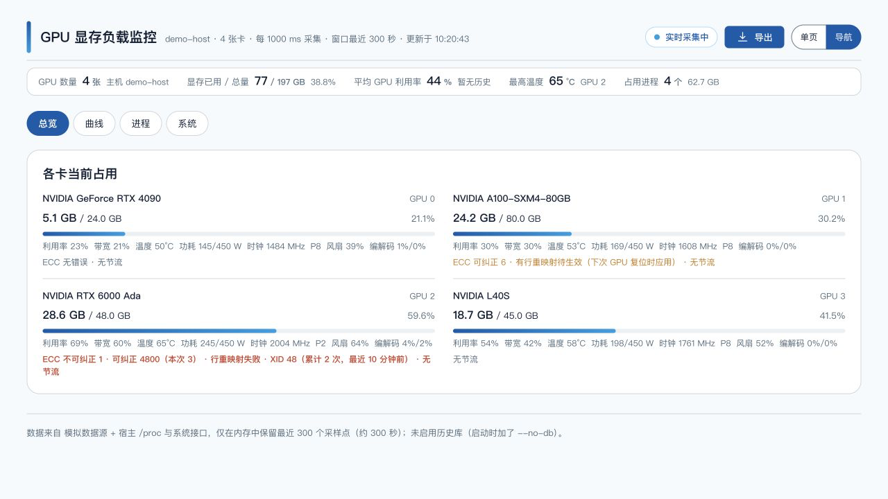
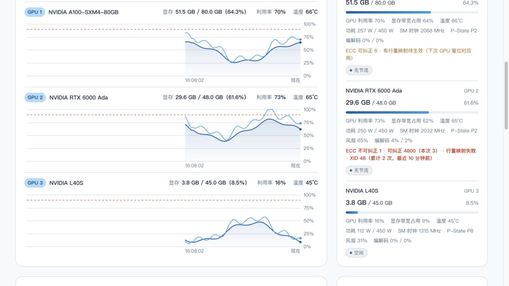

# GPU 显存负载监控

一台机器、多张显卡的显存负载实时看板。**零依赖**：只用 Node 内置模块 + `nvidia-smi`——不需要 `npm install`，不需要构建，也没有前端框架。

**中文** | [English](README.en.md)

[](LICENSE)
[](docs/deployment.md)


[](https://github.com/cmzt-coder/gpu-monitor/actions/workflows/ci.yml)

**导航模式**（按用途分页签，常驻区压成一两行；8 卡机器上各卡指标行也收成一行）



**单页模式**（所有卡片一次铺开，曲线与各卡卡片同屏对照）



<sub>以上都是 <code>--mock</code> 模拟数据的截图：卡型、服务名、主机名全是假的（主机名固定显示 <code>demo-host</code>）。界面右上角有语言下拉（<code>中 / EN</code>），英文界面见 <a href="README.en.md">English README</a>。</sub>

## 30 秒上手

```bash
git clone https://github.com/cmzt-coder/gpu-monitor.git
cd gpu-monitor
node server.js --port 8090              # 需要 Node ≥ 18；有 NVIDIA 卡就能直接看
node server.js --mock --port 8090       # 没有显卡的机器上先看效果
```

打开 <http://localhost:8090/>。要部署到服务器、让它开机自启（脚本 / systemd / cron 看门狗 / Docker），或者遇到 Node 版本、时区问题，看 **[部署与常驻](docs/deployment.md)**。

## 它能做什么

- **两种展示模式，随时切换**：**单页**把全部卡片一次铺开，看趋势、对状态方便对照；**导航**按用途分成「总览 / 曲线 / 进程 / 系统」四个页签，排查时不用滚好几屏。切换状态记在 URL（可分享、刷新保持）和浏览器本地存储里
- **一机多卡实时曲线**：每张卡一条「显存占用」+ 一条「GPU 利用率」。窗口是 `--window` 个点 × `--interval`——**所以它表示多长时间取决于采集间隔**（1 秒 = 5 分钟，3 秒 = 15 分钟）；服务重启后页面会**自动从历史库把前面那段补出来**，断档处如实断开
- **鼠标停在曲线上就能读数**：竖直参考线 + 跟随鼠标的浮窗，显示那一刻的时间与各系列值（每卡图、服务图、系统图都支持）。数据没攒满的空区不给读数，断档处如实写「无数据」
- **服务显存曲线**：把占卡进程按服务（容器 / systemd 单元 / 用户会话）汇总，最多画占用最高的 5 个。一张卡被多个服务共用时，这张图回答的是「是谁把显存吃上去的」
- **占用进程与进程占用历史**：PID / 进程名 / **服务归属** / 占用 / 占该卡比例，可按卡过滤；历史按「进程身份变化 + 每 5 分钟快照」留档，能回答「谁在什么时候占上了哪张卡」
- **硬件健康**：ECC（可纠正 / 不可纠正，本次与终身累计）、行重映射、XID——看的是「有没有在涨」，不是单点数字；读不到数据时如实说「读不到」，而不是显示 0
- **告警**：显存 / 温度 / 节流 / 利用率 / 宿主内存 / 磁盘 / 采集中断都能配阈值，还能**按服务**单独设规则；硬件健康类同样能配；支持「持续多久才算触发」与冷却抑制；通知渠道内置**邮件**、Webhook 和控制台
- **导出**：页面上只有一个入口，弹窗里选**内容**、**布局**（GPU 曲线支持宽表：一行一个采样点、每张卡各占一组列）、**时间范围**和选项；CSV 的时间列同时给本地时间与 UTC
- **历史存档**：SQLite 落库（`data/gpu-monitor.db`），重启不丢；页面可切 实时 / 3 天 / 7 天 / 30 天 / 60 天 / 90 天 / 全部
- **中英双语界面**：顶栏右上角的语言下拉（`中 / EN`）切换，不刷新页面、不重启服务；选择记在浏览器本地存储里，下次打开还是上次那种语言。缺省语言按 `navigator.language` 判定（中文浏览器给中文，其余给英文），也可以用 `?lang=en-US` 或 `#lang=en-US` 给某条链接指定语言
- 还有：宿主系统资源（CPU / 内存 / 交换分区 / 负载 / 磁盘 / 网络）、SSE 实时推送（不可用时自动退回轮询）、空闲自动降频、90% 警戒线与高温配色、异常时给出可复制的排查命令
- **顶栏只在出问题时报警**：一切正常时顶栏不显示状态胶囊（省得一行字天天挂着），一旦采集失败 / 连接中断 / 数据陈旧 / 退回轮询 / 空闲降频，它会自己出现并说明是哪一种

## 平台支持

| 平台 | 支持情况 | 采集方式 |
| --- | --- | --- |
| Linux | ✅ 完整支持 | `nvidia-smi`（`PATH` / `/usr/bin` / `/usr/local/bin`，也自动识别 WSL2 的 `/usr/lib/wsl/lib`） |
| Windows | ✅ 完整支持 | `nvidia-smi.exe`（`PATH` / `C:\Windows\System32` / `NVSMI`） |
| macOS | ❌ 不适用 | 官方驱动已停止支持，系统里没有 `nvidia-smi`；页面会明确提示，服务本身能正常启动（可用 `--mock` 预览界面） |

当前只支持 NVIDIA；AMD（`rocm-smi`）、Intel（`xpu-smi`）尚未实现，探测层预留了扩展位置。最新版的扩展字段（时钟 / P-State / 风扇 / PCIe / 编解码 / 节流原因 / ECC 计数）按驱动逐个探测，不支持的自动跳过并在页面上说明，也可以用 `--no-extended` 整个关掉。

## 文档

| 文档 | 内容 |
| --- | --- |
| [部署与常驻](docs/deployment.md) | 部署前自检、Node 版本升级、时区、四种常驻方式（脚本 / systemd / cron 看门狗 / Docker）、健康检查 |
| [启动参数与 HTTP 接口](docs/configuration.md) | 全部命令行参数与 `GET` 接口 |
| [告警与硬件健康](docs/alerts.md) | 告警指标全表、规则写法与示例、阈值建议；ECC / 行重映射 / XID |
| [平台支持与功能详解](docs/features.md) | 能读到什么、宿主指标的可用范围、服务归属怎么来的、历史库与长期维护 |
| [常见问题](docs/faq.md) | 页面或数据看起来不对时，先翻这里 |
| [开发与实现说明](docs/development.md) | 目录结构、实现口径、本地跑 mock、冒烟测试 |

## 界面语言

顶栏的 `中 / EN` 下拉是唯一入口，切换后**整页即时生效**（含 canvas 上的坐标轴文字与曲线读数浮窗）。它和旁边的「单页 / 导航」一样都是原生 `<select>`：收起时只占一行，英文文案（`Single page`）也不会把顶栏撑开。

- **优先级**：URL 显式指定（`?lang=` / `#lang=`）→ 上次的选择（`localStorage`）→ `navigator.language` → 中文
- **加新文案**：在 `public/i18n/zh-CN.js` 里加一条 key，再到 `en-US.js` 补同名的英文；两边 key 必须一一对应，占位符（`{name}`）也要一致。`node tools/smoke-test.mjs` 会逐条校验这两点，也会拦住"代码里用了但资源里没定义"的 key
- **单复数**：需要区分的写成 `xxx.one` / `xxx.other` 两条，代码里用 `tn('xxx', n)`（走浏览器内置的 `Intl.PluralRules`，不是第三方库）
- **不随语言变的**：数字格式（小数点、千分位）、时间格式（24 小时制）、单位（GB / MiB / % / °C / W）以及导出 CSV 的列名——它们要和导出的文件、日志、`nvidia-smi` 输出对得上
- **后端下发的诊断文本**（平台提示、采集告警、历史库不可用的原因等）由 `public/backend-text.js` 按"已知原文 → 文案 key"对照翻译；后端若改了这些句子的措辞，页面上会退回显示原文（不会空白或显示 key），冒烟测试里对每一条都有断言

## 许可

[MIT](LICENSE) © 2026 cmzt-coder
